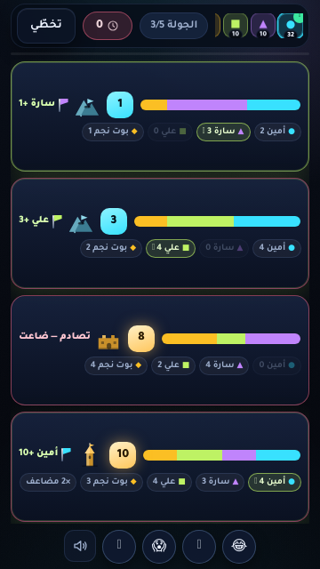
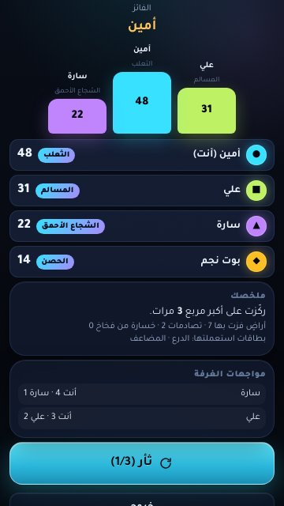

# ⚡ معركة الطاقة

لعبة ويب 2D متعددة اللاعبين (3 إلى 5) تُلعب على الهاتف. كل لاعب يوزّع **10 طاقة سراً** على المربعات، وبعد أن يقفل الجميع تُكشف الاختيارات معاً. على كل مربع، صاحب **أعلى طاقة** يفوز بقيمته. المباراة 5 جولات، وأكثر نقاط يفوز.

- واجهة عربية RTL بالكامل، عمودية، تُلعب بإصبع واحد.
- لا حسابات ولا تسجيل: اسم فقط.
- **السيرفر هو المرجع الوحيد** للحالة والحساب والمؤقت. اختيارات اللاعبين لا تُرسل لأي لاعب آخر قبل الكشف.

---

## الشاشات

| التوزيع | الكشف | بين الجولات | النهاية |
|---|---|---|---|
|  |  |  |  |


**فلسفة الواجهة (الإصدار ٢):**
- **الأراضي لها هوية**: منجم/حصن/برج مرسومة بـ SVG، لكل أرض اسم وقيمة بارزة في شارة.
- **الطاقة كرات لا أرقام**: بئر طاقة في أسفل الشاشة، والكرات تتراكم على الأرض كجيش. نقرة على الأرض تضع كرة، سحب من البئر يضعها حيث تُفلت، و`✎` للكتابة الدقيقة.
- **خصوم حاضرون**: شريط علوي فيه شكل كل لاعب ولونه ونقاطه؛ من يقفل يظهر عليه 🔒 بنبضة، والباقي «يفكّر». (لا يُكشف *مقدار* توزيع أحد قبل الكشف.)
- **الكشف معركة**: كل أرض تُقاس فيها الكرات، الفائز يرفع علمه بلونه وتطير نقاطه إلى شريط النقاط، والتعادل يهتز مع صوت تصادم.
- **معلومة تُغذّي الذكاء**: بين الجولات تظهر خريطة توزيع الجولة المنتهية (المكشوفة أصلاً) + سطر عادة («فلان يركّز على أكبر أرض ٢/٣»).
- **لغة حركة واحدة**: منحنى واحد `cubic-bezier(.2,.9,.25,1)` وثلاث مدد (120/220/420ms)، واهتزاز مرتبط بالمعنى.
- **أيقونات مرسومة (SVG)** لا إيموجي، لتبدو اللعبة نفسها على كل جهاز.

---

## التشغيل

```bash
npm install      # مرة واحدة (ws للسيرفر، jsdom للاختبارات فقط)
npm start        # http://localhost:3000
```

افتح الرابط على الهاتف (نفس الشبكة) أو من خلال معاينة السيرفر. للعب مع أصدقائك:
1. لاعب يضغط **«أنشئ غرفة»** فيحصل على رمز من 4 أحرف.
2. يشارك الرابط (`?room=CODE`) أو الرمز.
3. عند اكتمال 3 لاعبين يضغط المضيف **«ابدأ»**. لتجربة فردية: **«جرّب مع بوتات»**.

المنفذ قابل للتغيير: `PORT=8080 npm start`.

---

## بنية المشروع

| الملف | الدور |
|---|---|
| `game.js` | محرك القواعد النقي: سحب المربعات والحدث، حساب الجولة، البطاقات، الألقاب، البوتات. بلا شبكة ولا DOM. |
| `server.js` | سيرفر HTTP + WebSocket: الغرف، المؤقتات على السيرفر، التعقيم (sanitization)، إعادة الدخول، البوتات، سجل المباريات. |
| `public/index.html` | هيكل الصفحة. |
| `public/styles.css` | التصميم (كحلي داكن + نيون)، الهاتف أولاً. |
| `public/app.js` | العميل: الشاشات، التوزيع، الكشف، الأصوات، الاهتزاز، Wake Lock. |
| `test/` | اختبارات القبول (محرك + شبكة + عميل حقيقي في jsdom + النقل البديل). |
| `logs/matches.jsonl` | سجل المباريات بلا أسماء (البطاقات المختارة والمستعملة ونتيجة كل لاعب) لمراجعة نسب الفوز لكل بطاقة. |

---

## القواعد كما نُفِّذت

| البند | القيمة |
|---|---|
| اللاعبون | 3–5 · المربعات = اللاعبون + 1 |
| الجولات | 5 |
| الطاقة | 10 لكل جولة (وفرة: 14) — لا تُرحَّل |
| قيم المربعات | سحب بلا تكرار من {1..6}، مرتّبة تصاعدياً |
| مؤقت التوزيع | 25 ثانية في الجولة الأولى، 20 بعدها (ينتهي مبكراً عند قفل الجميع) |
| تعويض الأخير | +3 طاقة في الجولة التالية (التعادل يُحسم عشوائياً) |
| الأحداث | عادي 40٪ · ذهبي 20٪ · مقلوب 20٪ · وفرة 20٪ — الأولى عادية دائماً، ولا يتكرر خاص مرتين متتاليتين |

**حساب الجولة بالترتيب:** (1) اللص قبل التوزيع ← (2) الفائز على كل مربع مع الدرع وقاعدة التعادل ← (3) القناص ← (4) المضاعف ← (5) الفخ ← (6) ضم النقاط.

- التعادل على الأعلى: يفوز **الأقل نقاطاً** في الترتيب، وإن تساوت نقاطهم يضيع المربع (حركة تصادم).
- القفل نهائي، ولا يُقبل قبل توزيع كل الطاقة. عند انتهاء الوقت يُكمل السيرفر الباقي تلقائياً على المربعات التي عليها شيء (أو بالتساوي إن لم يضع اللاعب شيئاً).
- البطاقات: 3 من 5 قبل المباراة (15 ثانية وإلا عشوائياً)، كل بطاقة مرة واحدة، وبطاقة واحدة كحد أقصى في الجولة، وتُفعَّل قبل القفل.

---

## الشبكة والحالات الصعبة

- WebSocket مع نبضات حياة كل 20 ثانية. عند الانقطاع: إعادة دخول تلقائية بنفس الاسم والرمز المخزّن على الجهاز، ويعود اللاعب إلى حالته والوقت الباقي من السيرفر.
- إن حجب وسيط الشبكة ترقية WebSocket، ينتقل العميل تلقائياً إلى نقل بديل (HTTP طويل الانتظار) بنفس المنطق — اختُبر كاملاً.
- اللاعب الغائب عند القفل يلعب عنه بوت (يُعلَّم «بوت») ويعود في الجولة التالية.
- خروج المضيف ينقل الإدارة، والغرفة الفارغة تُحذف بعد 10 دقائق. الحالة في الذاكرة فقط.
- من يدخل بعد بدء المباراة يصبح **متفرجاً** فقط.

---

## الاختبارات

```bash
npm test
```

31 اختباراً تشمل:
- **المحرك**: سحب المربعات والحدث وترجيحه، التعادل بنقاط مختلفة/متساوية، الدرع ودرعان متقابلان، القناص بعد الدرع، المضاعف مع الفخ، الفخ مع الذهبي، تعويض الأخير، الألقاب، وإجهاد 5000 جولة عشوائية.
- **الشبكة**: مباراة 3 لاعبين كاملة 5 جولات حتى «ثأر»، فحص أن لا اختيارات لأحد في رسائل غيره قبل الكشف، انقطاع أثناء التوزيع وعودة اللاعب، منع الدخول بعد البدء، الأسماء الفريدة والحد 5 وانتقال الإدارة، ومباراة كاملة بلا تدخل بشري.
- **العميل** (jsdom على الواجهة الحقيقية): من الاسم إلى الكشف مع توزيع بالأزرار، اختيار البطاقات، زر القفل المعطّل ثم المفعّل، شاشة الانتظار، الكشف والتخطّي، «كيف تلعب؟»، التجربة مع البوتات (5 مربعات)، ورابط الغرفة — وأيضاً العمل عبر النقل البديل.

الاختبارات تُشغّل السيرفر بوضع `EB_FAST=1` (تسريع المؤقتات فقط، والقواعد كما هي).

---

## ملاحظات تنفيذية (قرارات في نقاط لم تُحددها المواصفة)

1. **المربع الذهبي**: أعلى قيمة في اللوحة تُضاعف وقت الحساب (لا تتغير الشارة قبل الكشف)، ويُعرض عليه `×2` لأنه معلومة عامة.
2. **درعان على المربع نفسه**: يلغيان بعضهما ← تعود قاعدة أقل نقاط، وإن تساوت النقاط يضيع المربع.
3. **فخّان على المربع نفسه**: كل فخ يُحسب على حدة (خسارة 3 لكل فخ).
4. **اللص على لاعب قفل بالفعل**: يُسمح به، ويقصّ السيرفر الفائض من أكبر المربعات ويُعلم اللاعب الجديد بطاقته.
5. **تعويض الأخير** يُحسب بعد كل جولة (1→4) ويُطبَّق في الجولة التالية، ويُضاف فوق طاقة الوفرة.
6. **البوتات**: 3 بوتات في وضع التجربة (4 لاعبين، 5 مربعات). وفي المباراة تُستخدم البوتات فقط عند غياب لاعب أو عند نقص العدد.
7. **ما هو معلن لكل اللاعبين أثناء الجولة** (لتشعر بالمنافسة الحيّة): النقاط، و**الطاقة الإجمالية** لكل لاعب (الأساس 10/14 معلوم، والتعويض يُعلَن، واللص يُعلَن أثره) وحالة القفل. أما **التوزيع** و**بطاقة الجولة** و**البطاقات المختارة/المستعملة** فتبقى سرّية تماماً حتى الكشف — وهذا مُغطّى باختبار آلي يفشل عند أي تسريب.
7. **ثأر**: يبدأ عندما يجمع 3 أصوات، مع شرط صوت بشري واحد على الأقل (البوتات تصوّت بعد 12 ثانية حتى لا تعلق التجربة الفردية).
8. **الفائز باللقب** لا يتكرر لقب بين لاعبين: تُمنح الألقاب بترتيب أولوية، والباقي يأخذ من القائمة الاحتياطية.

أي رغبة في تعديل الأرقام (الطاقة، المؤقتات، نسب الأحداث) موجودة في `game.js` داخل `CONFIG` و`EVENT_TABLE`.
